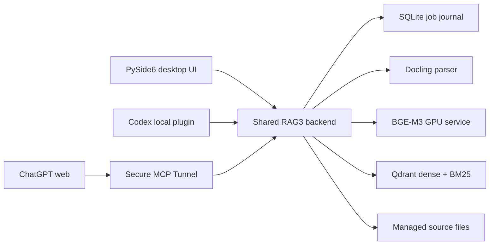

# RAG3 — local document search for desktop and ChatGPT

RAG3 is a Windows document indexing and retrieval system with a desktop UI, a shared HTTP backend, and MCP tools. It parses local files with Docling, indexes them in Qdrant, and searches with BGE-M3 semantic vectors, native BM25, or hybrid rank fusion.

This repository contains the indexing and retrieval service. Model weights, personal documents, the Qdrant volume, and tunnel credentials are not part of the source tree.

**ChatGPT on the web can search your RAG3 collections.** Run RAG3 on your Windows PC, connect its local MCP endpoint through [OpenAI Secure MCP Tunnel](https://developers.openai.com/api/docs/guides/secure-mcp-tunnels), and install the resulting custom MCP plugin in ChatGPT. This path was exercised on the development PC. Each installation needs its own tunnel and ChatGPT workspace access; cloning this repository alone does not connect ChatGPT. See [MCP setup](docs/usage.md#chatgpt-on-the-web).

## Engineering highlights

- **One backend for three clients.** The PySide6 UI, local Codex plugin, and ChatGPT web plugin use the same collections, ingestion jobs, and retrieval path. Closing the UI leaves the backend running.
- **GPU ownership on a 4 GiB card.** Long PDFs use a short-lived CUDA parser. RAG3 releases BGE-M3 before parsing and reloads it for embedding or semantic search, while BM25-only search stays available without the dense model.
- **Recoverable ingestion.** A SQLite job journal records progress and state; the UI can pause, resume, retry, and cancel jobs. Managed source copies carry SHA-256 checks for source retrieval.
- **Inspectable retrieval.** BGE-M3 dense vectors and Qdrant's native BM25 sparse vectors support semantic, lexical, and reciprocal-rank-fusion search. Results retain source metadata and PDF page information when available.
- **Format-aware parsing.** Docling handles PDF OCR and tables plus structured formats; plain text has a direct path. Legacy `.doc` conversion uses Microsoft Word when installed.



The [architecture notes](docs/architecture.md) explain the data flow, GPU handoff, and retrieval behavior.

## Requirements at a glance

| For | Required components |
| --- | --- |
| Desktop UI and backend | Windows x64, Python 3.11, NVIDIA GPU and compatible driver, WSL2 Ubuntu, Docker Engine and Compose in Ubuntu, Qdrant, local BGE-M3 and Docling models |
| Optional launcher | .NET 8 runtime; .NET 8 SDK only to build `RAG3.exe` |
| Local Codex MCP plugin | Running backend and Codex with local plugin support |
| ChatGPT web MCP plugin | Running backend, Secure MCP Tunnel client and permissions, ChatGPT custom MCP plugin access |

Microsoft Word is needed only for legacy `.doc` conversion. The [Windows installation guide](docs/install-windows.md) lists the setup and checks for every component.

## Quick start

Follow the [Windows installation guide](docs/install-windows.md) to set up WSL2, Docker, Qdrant, Python packages, and local model files. The launcher is optional.

Once the environment and Qdrant are ready, start the shared backend in one PowerShell window:

```powershell
.\.venv\Scripts\python.exe scripts\rag3-mcp-server.py
```

In another window, open the UI:

```powershell
.\.venv\Scripts\python.exe scripts\ingest-ui.py
```

Create a collection, add a PDF, run its job, then search the collection. The backend also serves `http://127.0.0.1:8000/mcp` for local MCP clients. See [Using RAG3](docs/usage.md) for the UI and MCP paths.

## Verification and limits

The [verification notes](docs/verification.md) include a repeatable disposable PDF-to-search check and one measured 535-page local run. On a Quadro T1000 with 4 GiB VRAM, that run indexed 252 chunks in 30.7 minutes and found the source through dense, BM25, and hybrid search. Device-wide GPU usage reached 3,873 MiB. These numbers describe one document and PC, not a general performance guarantee.

The code and workflow have been exercised on the development PC. A clean installation on a second PC has not yet been completed. The bundled infrastructure script currently expects the checkout at `C:\python_program\RAG3`; other locations require editing that script.

## License and published content

The source code and documentation are available under the [MIT License](LICENSE). The repository does not include your indexed documents, model weights, local `.env`, Qdrant data, or tunnel credentials. ChatGPT and other MCP clients receive document content only when you invoke the corresponding tools; review access and write permissions before connecting a client.
