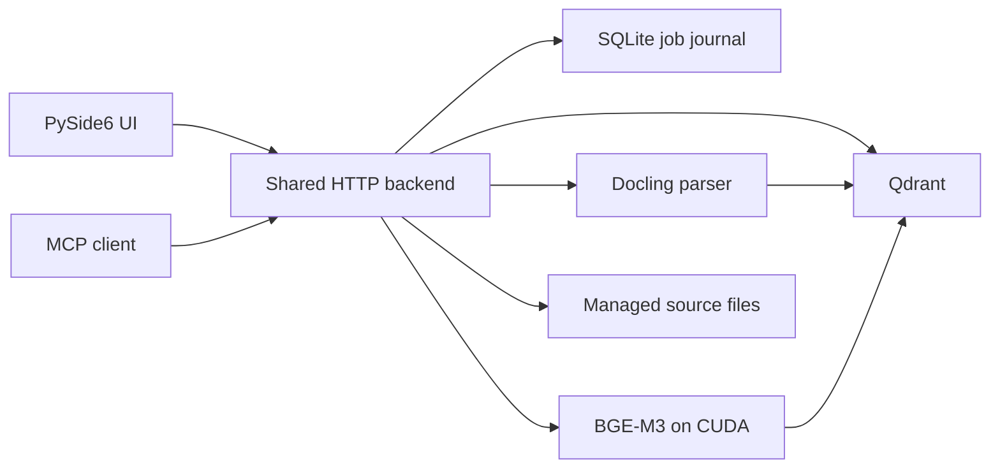

# Architecture

RAG3 has one backend process for ingestion, retrieval, the local UI API, and MCP. The PySide6 window is a client of that backend. Qdrant runs separately in Docker under WSL2.

## Ingestion

1. The backend copies an input file under `data/sources/` and records its SHA-256. MCP attachments are downloaded before being queued.
2. Docling converts PDFs and structured formats. Plain TXT, JSON, JSONL, and TSV go directly to the text splitter. Legacy `.doc` is converted to DOCX with Microsoft Word first.
3. The splitter makes 1,024-token chunks with 128-token overlap. The parser stages chunk text and metadata in Qdrant before embeddings are written.
4. BGE-M3 produces 1,024-dimensional dense vectors. Qdrant generates native BM25 sparse vectors from the same chunk text.
5. The job journal in `data/ingestion_jobs.sqlite` tracks progress, pause, resume, and failures. Original files remain available for source viewing.

PDF OCR and table structure extraction are enabled. Picture image generation is disabled. Page numbers are stored for PDF chunks when Docling supplies them.

## GPU scheduling

On the tested 4 GiB GPU, keeping the PDF parser and BGE-M3 loaded together is too tight. For PDFs of at least eight physical pages, the backend finishes the current BGE batch, releases BGE-M3, runs a short-lived CUDA parser, then reloads BGE-M3 for embedding or the next semantic query. A resident CPU parser handles shorter PDFs and other supported formats. `RAG3_CUDA_PARSE_MIN_PAGES` changes the eight-page threshold.

Semantic search waits while the CUDA parser owns the GPU. BM25-only search can continue without loading BGE-M3. This handoff limits concurrent GPU model residency; it does not guarantee a fixed peak VRAM for every PDF.

## Retrieval and clients

Search can use BGE-M3 dense vectors, Qdrant BM25, or both. Hybrid retrieval merges ranked results with reciprocal rank fusion. The UI and MCP clients call the same backend search path and share collections and ingestion jobs.

The backend binds its HTTP service to `127.0.0.1` by default. The UI uses a local authenticated command API; local MCP clients use `/mcp`. A remote client needs a separately configured tunnel. The repository does not contain tunnel credentials.

For the client workflow and main MCP tools, see [Using RAG3](usage.md).
